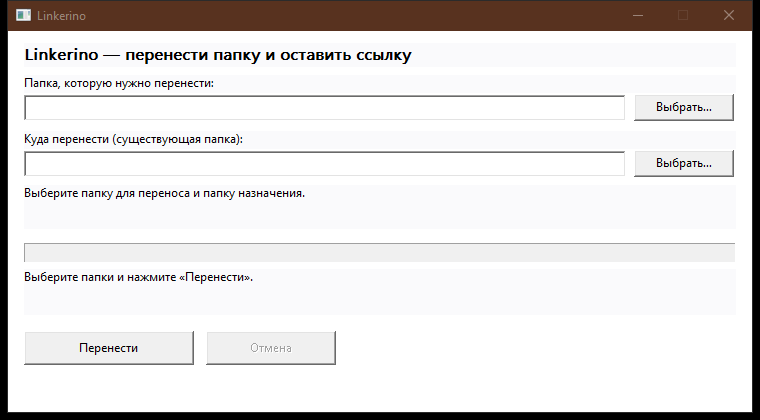
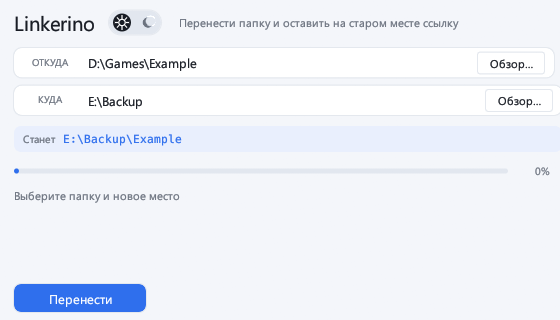
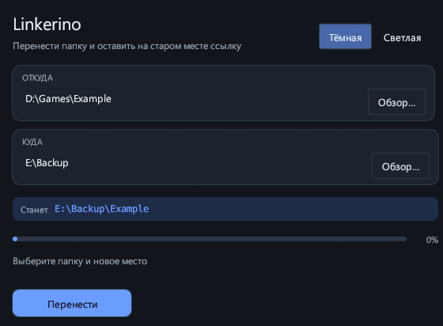
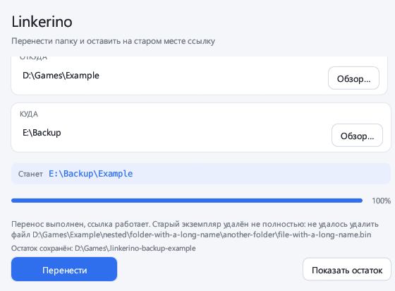
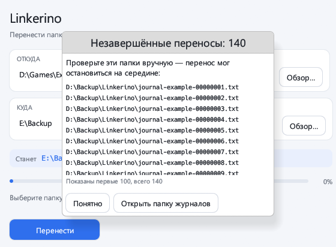

# Linkerino

> Переносит папку на другой диск и оставляет на старом месте настоящую символьную ссылку
> каталога — как `mklink /D`, только в пару кликов и с проверкой каждого байта.

[](LICENSE)
[](https://github.com/kabzon93region/Linkerino/releases/latest)
[](#технические-характеристики)
[-lightgrey)](#технические-характеристики)
[-informational)](#технические-характеристики)
[](#сборка)
[](#версия-20-на-rust)
[](#как-это-работает)
[](#технические-характеристики)
[](docs/architecture/CODE_MAP.md)
[](https://github.com/kabzon93region/Linkerino/actions/workflows/build.yml)

Один исполняемый файл без установки, .NET и Visual C++ Redistributable. Вы выбираете папку,
выбираете новое место — программа копирует, сверяет содержимое по SHA-256 и только потом
заменяет старый путь ссылкой. Если что-то пошло не так, оригинал остаётся на месте.



## Версия 2.0 на Rust

Тот же порядок переноса, переписанный на Rust, и компактное окно без пустых панелей:



Тема переключается прямо в окне и запоминается: светлая или тёмная.



После переноса окно показывает итог и, если старый экземпляр пришлось сохранить, путь остатка:



- В окне только нужное: откуда, куда, итоговый путь, прогресс и кнопки. Высота — 320 точек, пути и «Обзор…» в одной строке. Кнопка «Обзор…» открывает диалог на уровень выше уже введённого пути, поэтому следующая папка выбирается рядом с текущей, а не там, где закончился прошлый выбор.
- Тема переключается тумблером с солнцем и месяцем рядом с названием и хранится в `%LOCALAPPDATA%\Linkerino\settings.txt`.
- Один `Linkerino.exe` — около 3,2 МБ (3 378 688 байт в локальной сборке, 3 379 200 байт в артефакте CI), без установки, .NET и Visual C++ Redistributable (статический CRT).
- Иконка окна и файла — папка со значком ссылки; встроена в EXE (`rust/assets/linkerino.ico`).
- Окно показывает записи, требующие внимания: незаконченный перенос, оставшийся резерв или нечитаемый журнал. Список прокручивается, кнопки «Понятно» и «Открыть папку журналов» всегда под рукой.


- Есть полноценная командная строка без окна: `--transfer`, `--plan`, `--journals`, `--json`, коды возврата — см. раздел [«Командная строка»](#командная-строка); тема для снимков задаётся флагом `--theme light|dark`.
- Порядок безопасности тот же: копия → сверка → публикация → ссылка → удаление резерва.

Что проверено в этой сборке: 31 интеграционный тест движка на NTFS (перенос, кириллица, ссылки внутри папки,
жёсткие ссылки, junction и относительные ссылки внутри папки, потоки файлов и каталогов, длинные пути, отмена, нехватка места, сбой копирования,
сбой сразу после создания файла, сбой сверки, сбой ссылки, сбой подтверждения записи, состояния и
нечитаемость журнала, отказ при журнале внутри источника или будущей копии до первой записи, обычный перенос
при журнале рядом с источником, сохранение всего резерва при изменении копии после сверки) и 11 модульных тестов (тема, разбор команд и стартовый каталог диалога, удержание файла от записи), сборка
release и smoke-скрипт с настоящим переносом и открытием окна. Тест основного сценария
дополнительно требует, чтобы после успеха резерв был удалён: локально запись подтверждается
`MOVEFILE_WRITE_THROUGH` и сбросом каждого файла, сброс тома — дополнительный шаг. Ветка
«запись не подтверждена» проверяется тестовым отказом: тогда резерв остаётся и путь показывается.
Сетевая шара идёт по той же ветке (подтверждения там нет по определению), но реальный SMB-приёмник
в этой сборке не проверялся. Сверка сравнивает не только каждый объект, но и весь набор путей:
лишний или пропавший файл останавливает перенос. Скорость: на дереве из 4000 файлов по 1 КиБ и
четырёх по 8 МиБ полный перенос занимает около 30 секунд на машине разработчика (медиана трёх
прогонов, источник и назначение на одном диске); небольшая папка переносится за 1–2 секунды.

Что не проверялось для Rust-сборки: приёмники exFAT/FAT32/ReFS/SMB, Windows 11, сбой питания,
отключение устройства. Интерфейс рисуется через OpenGL 3.2, поэтому на старых системах без свежих
драйверов окно может не открыться. Классическая сборка на C++ (1.1) остаётся в репозитории и
работает без OpenGL, но она **архивная**: гарантии 2.3 (проверка и удаление на одном дескрипторе,
учёт созданных объектов, журнал v3) в неё не переносились, и её интерфейс в этом выпуске не
проверялся — используйте её только как запасной вариант.

## Что делает

| | |
|---|---|
| Выбор папок | стандартные диалоги Windows или ручной ввод пути |
| Копирование | файлы, пустые каталоги, даты, атрибуты, права доступа, именованные потоки NTFS, длинные пути |
| Ссылки внутри папки | символьные ссылки, junction и жёсткие ссылки пересоздаются с прежними целями |
| Проверка | набор путей, размеры, даты, DACL, SHA-256 данных и потоков, цели ссылок |
| Замена | старая папка переименовывается в резерв, создаётся символьная ссылка, проверяется её цель |
| Освобождение места | старый экземпляр удаляется с повторной проверкой каждого файла |
| Сбои | оригинал не удаляется; журнал операций, требующих внимания, в `%LOCALAPPDATA%\Linkerino` |
| Отмена | до момента переключения; после публикации кнопка гаснет |

## Почему это безопасно

1. Пока копия не сверена полностью, исходная папка не меняется.
2. Перед переключением источник проверяется ещё раз: изменился — перенос останавливается.
3. Ссылка создаётся только после публикации и проверяется: тег reparse, цель, совпадение
   идентификатора каталога с томом и индексом проверенной копии.
4. Перед удалением копия сверяется повторно, а запись подтверждается так: каждый файл
   сбрасывается на диск сразу после записи, а переименования идут с `MOVEFILE_WRITE_THROUGH`.
   Для сетевой шары подтверждения нет — резерв остаётся, и путь виден в окне.
5. Удаление идёт файл за файлом с повторной проверкой идентификатора, размера, даты и
   SHA-256 на том же дескрипторе, которым выполняется удаление. Любое расхождение — стоп,
   остаток сохраняется.
6. Если ссылку создать не удалось, исходное имя восстанавливается, проверенная копия
   остаётся на новом месте.

## Технические характеристики

| | |
|---|---|
| Язык | **Rust** (`windows-sys`, `eframe`/`egui`) — рабочая версия; C++17 (1.1) остаётся в репозитории как архивная |
| Сборка | `cargo build --release` (CRT вкомпилирован); архивная C++ — MSVC 2019, CMake ≥ 3.16, `/MT` |
| Бинарник | `Linkerino.exe` x64, ~3,2 МБ (Rust); x86 ~300 КБ (архивная C++ 1.1) |
| ОС | проверено: Windows 10 22H2 x64, нужен OpenGL 3.2. Windows 11 — ожидается, отдельно не проверялась; Windows 7 SP1/8/8.1 — только архивная сборка |
| Файловые системы | источник — **NTFS** (иначе некуда ставить ссылку), проверено; назначение — **NTFS** проверено. exFAT, FAT32, ReFS и SMB-шары поддержаны в коде, но реальными прогонами в этой сборке не проверялись |
| Зависимости | системные DLL Windows + `opengl32`; Visual C++ Redistributable не нужен |
| Тесты | **31 интеграционный + 11 модульных** (Rust) и дымовой скрипт; архивная C++ — 139 проверок на стендах с VHD и SMB |
| Лицензия | MIT |

## Как пользоваться

1. Запустите `Linkerino.exe` от имени администратора: ссылку может создать не каждая учётная
   запись. Сборка C++ без прав предложит перезапуск; Rust-версия покажет ошибку и ничего не изменит.
2. «Папка, которую нужно перенести» — кнопка «Выбрать…» или ручной ввод.
3. «Куда перенести» — существующая родительская папка. Имя подставляется само, итоговый
   путь показан под полями.
4. Нажмите «Перенести» и подтвердите. Прогресс, этап и текущий файл — в окне.

Пример: `D:\Games\Example` + `E:\Backup` → появится `E:\Backup\Example`, а `D:\Games\Example`
станет ссылкой на неё.

## Как это работает

1. **Проверка** — права на ссылку (пробная ссылка рядом с исходной папкой), возможность записи
   на новом месте, отсутствие коллизий и вложенности, запрет корней, системных каталогов и профиля.
2. **Снимок** — дерево в pre-order: идентификаторы, размеры, даты, атрибуты, сигнатура DACL,
   именованные потоки, цели ссылок и junction, группы жёстких ссылок. Неподдерживаемые объекты
   отсекаются до копирования.
3. **Копирование** — во временную папку `.linkerino-stage-<guid>` на новом диске, с SHA-256
   по ходу чтения и сбросом каждого файла на диск; права ставятся явно (protected ACL), ссылки
   и junction пересоздаются с прежними целями, жёсткие ссылки — через `CreateHardLinkW`.
4. **Сверка** — набор путей, типы, размеры, даты, права, хэши данных и потоков, цели ссылок,
   число жёстких ссылок; затем повторная проверка неизменности источника.
5. **Публикация** — переименование в итоговое имя, фиксация тома и индекса каталога.
6. **Ссылка** — оригинал переименовывается в `.linkerino-backup-<guid>`, создаётся
   `CreateSymbolicLinkW`, проверяется цель и идентификатор каталога.
7. **Удаление** — обратный обход резерва с повторной проверкой каждого файла, ссылка
   проверяется каждые 32 элемента.

Возможности файловой системы определяются до копирования: NTFS даёт права, потоки и ссылки;
exFAT/FAT32 — только данные, даты и атрибуты; SMB проверяется пробой. Что не удалось перенести,
программа пишет в итоговом сообщении.

## Командная строка

То же приложение умеет работать без окна: команда выполняется, результат печатается в консоль,
окно не открывается. Один и тот же `Linkerino.exe` — и графика, и CLI.

```powershell
Linkerino.exe --transfer "D:\Games\Example" "E:\Backup"   # перенести и поставить ссылку
Linkerino.exe --plan "D:\Games\Example" "E:\Backup"       # только проверить пути
Linkerino.exe --transfer "D:\Games\Example" "E:\Backup" --dry-run --json
Linkerino.exe --journals                                  # записи, требующие внимания
Linkerino.exe --version
Linkerino.exe --help
```

| Параметр | Что делает |
|---|---|
| `--transfer <папка> <куда>` | перенести папку и оставить на старом месте ссылку |
| `--plan <папка> <куда>` | проверить пути и показать итоговый путь, ничего не меняя |
| `--dry-run`, `-n` | то же, что `--plan`; можно и без `--transfer` |
| `--journals` | записи, требующие внимания: незаконченный перенос или оставшийся резерв |
| `--version`, `--help` | версия и справка |
| `--json` | итог и ошибки одной JSON-строкой в stdout |
| `--quiet`, `-q` | без строк прогресса |
| `--` | дальше только пути (если путь начинается с «-») |

Итог в JSON: `{"ok":true,"cancelled":false,"dest":"E:\\Backup\\Example","message":"…","detail":"","notes":"","leftover":""}`.
Прогресс и сообщения об ошибках идут в stderr, итог — в stdout; при `--json` в stdout только JSON-объект (кроме `--help` и `--version` — они всегда печатают текст).

Коды возврата: `0` — успех, `1` — отказ или ошибка переноса, `2` — ошибка в параметрах,
`3` — отменено по Ctrl+C (перенос останавливается до замены оригинала). Без параметров
запускается графический интерфейс.

## Сборка

```powershell
cmake -S . -B build/win32 -G "Visual Studio 16 2019" -A Win32
cmake --build build/win32 --config Release
ctest --test-dir build/win32 -C Release --output-on-failure
```

Готовый файл: `build\win32\Release\Linkerino.exe`.

Версия 2.0 на Rust собирается отдельно и не требует CMake:

```powershell
cd rust
cargo build --release
cargo test --release -- --test-threads=1
```

Готовый файл: `rust\target\release\Linkerino.exe`. Скрипт `scripts\smoke-rust.ps1` проверяет
перенос без интерфейса, окно и сохраняет три снимка окна (светлая тема, итог, тёмная тема).

Для встраивания иконки и сведений о версии `rust/build.rs` вызывает `rc.exe` из Windows SDK —
он ставится вместе с Visual Studio Build Tools. Без SDK сборка остановится с понятной ошибкой.

## Тесты

```powershell
ctest --test-dir build/win32 -C Release --output-on-failure
powershell -ExecutionPolicy Bypass -File scripts\gui-smoke.ps1
powershell -ExecutionPolicy Bypass -File scripts\gui-no-rights.ps1
powershell -ExecutionPolicy Bypass -File scripts\test-filesystems.ps1
powershell -ExecutionPolicy Bypass -File scripts\smoke-rust.ps1
```

`scripts\test-filesystems.ps1` создаёт временный VHD, форматирует его в exFAT и FAT32, проверяет
перенос, затем то же самое на локальной SMB-шаре. Нужны права администратора. Скрипт
`scripts\smoke-rust.ps1` проверяет Rust-сборку: перенос без интерфейса, окно и три снимка окна.

Тесты запускайте от имени администратора: часть сценариев проверяет символьные ссылки и
сброс записи на диск. Без прав тестовый бинарник возвращает код 77 (ctest показывает
`Skipped`), потому что проверить эти пути честно нельзя.

Сценарии: перенос и пустая папка, кириллица и пробелы, именованный поток, поток на каталоге,
длинный путь (>260 символов), символьная ссылка, относительная ссылка внутри и вне папки,
битая ссылка, junction, жёсткие ссылки (в том числе с потоком и на длинном пути), перенос
между дисками `C:` и `Z:`, занятый файл, изменённый источник, подмена копии после публикации,
пропавшая ссылка до и во время удаления, нехватка места, подтверждение записи, отказ для EFS
и облачных заглушек, отмена, сбой сверки, сбой ссылки, журнал восстановления.

## Ограничения

- Источник должен лежать на **NTFS/ReFS** (локально или на SMB-шаре): ссылку на старом месте
  можно создать только там. Назначение — NTFS, ReFS, exFAT, FAT32 или SMB-шара.
- На exFAT/FAT32 и части SMB-шар теряется то, что они не умеют: права доступа NTFS,
  именованные потоки и ссылки внутри папки, а жёсткие ссылки копируются как отдельные файлы. Потеря не молчаливая — программа перечисляет её
  в итоговом сообщении, а перенос папки со ссылками на такую ФС отклоняется заранее.
- Буква диска должна оставаться за тем же диском: без него ссылка не откроется, а если
  букву займёт другой диск, ссылка может открыть чужую папку с таким же путём.
- Владелец файлов не переносится; DACL (на NTFS), даты и атрибуты — переносятся. На FAT/exFAT
  точность дат ограничена файловой системой.
- Разреженные и сжатые файлы копируются как обычные; на новом диске нужно место под полную
  копию (внутри одного диска — временно двойной размер).
- На источнике с неуникальными файловыми индексами (некоторые NAS) независимые файлы с одинаковым содержимым могут стать одной жёсткой ссылкой; данные сохраняются, но связь может отличаться от исходной.
- На сетевом томе нельзя подтвердить сброс метаданных тома: считается, что данные
  подтверждены сбросом каждого файла (SMB). На локальном томе для удаления старого
  экземпляра нужен доступ на запись к тому (обычно права администратора).
- Во время самого удаления изменения копии не отслеживаются: проверяется доступность
  ссылки каждые 32 элемента (полная сверка выполняется перед удалением).
- Не проверялись фактически: Windows 7 SP1, 8, 8.1, 11, сбой питания, отключение USB
  во время работы. Совместимость основана на используемых API, а не на прогоне.
- Для Rust-сборки (2.0) не проверялись приёмники exFAT/FAT32/ReFS/SMB и Windows 11.
  Windows 7 SP1/8/8.1 для неё не заявлены: нужен OpenGL 3.2, и такие системы в этой сборке
  не запускались. Работа без интерфейса (`Linkerino.exe --transfer <папка> <куда>`) доступна
  везде, где запускается EXE, но заявленная матрица для Rust — Windows 10/11 x64.

## Структура

```text
src/                 движок и интерфейс C++ (1.1)
  win_util.*         пути, тома, возможности файловых систем, ссылки, журнал работы
  engine.*           снимок, копирование, сверка, публикация, удаление
  main_win32.cpp     окно Win32 и рабочий поток
src/tests/           интеграционные тесты на временных каталогах
.cargo/config.toml   статический CRT для Rust (rustflags), как `/MT` в C++
rust/                версия 2.0: движок и интерфейс на Rust
  build.rs           ресурсы Windows: иконка и сведения о версии
  assets/            linkerino.ico и PNG-варианты иконки
  src/lib.rs         модули движка
  src/win.rs         пути, тома, ссылки, права доступа, потоки
  src/engine.rs      снимок, копирование, сверка, публикация, удаление
  src/main.rs        окно egui, режимы --transfer и --screenshot
  tests/             интеграционные тесты движка
scripts/             оконные сценарии, тесты exFAT/FAT32/SMB, дымовые тесты и снимки окна
  make-icon.py       перерисовка иконки из геометрии (dev-скрипт, нужен Pillow)
docs/                спецификация, план, карта кода, снимок окна
```

Подробности: [карта кода](docs/architecture/CODE_MAP.md),
[спецификация](docs/superpowers/specs/2026-11-24-linkerino-design.md), `docs/images/`.

## Что нового в 2.3.2

- Перед удалением резерва программа сверяет опубликованную копию целиком и, если та изменилась, не удаляет ничего. Затем каждый файл и ссылка проверяются ещё раз и удерживаются открытыми без общего доступа на запись: изменить или подменить их между проверкой и удалением уже нельзя. Изменение, замеченное до первого удаления, оставляет резерв целиком; замеченное позже — останавливает удаление и сохраняет остаток, а итог честно говорит, где лежат данные.
- Папка журналов проверяется до первой записи: если журнал оказался внутри переносимой папки или внутри будущей копии, перенос не начинается — иначе запись журнала воссоздавала старый путь и ломала и ссылку, и откат.
- Тестов стало 31 интеграционный + 11 модульных: оба случая сначала воспроизводились падающими тестами, затем закрыты.

## Что нового в 2.3

- План привязан к объектам: подмена папки по тому же пути после проверки останавливает перенос.
- Проверка и удаление резерва идут на одном дескрипторе; удаляются только созданные этой операцией объекты; каталог удаляется лишь пустым; при расхождении остаток сохраняется.
- Честный откат: убирается только ссылка, ведущая на нашу копию, а сообщение говорит, что реально восстановлено.
- Журнал v3: атомарная запись, идентификаторы объектов, состояния `published`/`backup`/`linking` до шага, при запуске видны сохранённые резервы, потерянная ссылка и нечитаемые записи («Требуют внимания»).
- Ссылка внутрь переносимой папки пересоздаётся на новое место (включая junction), внешняя сохраняет свою форму; потоки сравниваются по имени; атрибуты каталогов сверяются.
- Именованные потоки и потоки каталогов на приёмнике без поддержки — отказ до копирования; явные права и жёсткие ссылки — резерв сохраняется, причина сообщается.
- Новый файл получает права источника до закрытия дескриптора; нечитаемый DACL считается «есть что терять».
- Строгий разбор имён, путей, потоков и аргументов командной строки: нечитаемое имя даёт ошибку, а не подмену символов.
- Отмена действует на всех долгих циклах до публикации; закрытие окна во время переноса откладывается до безопасной точки; окно не блокируется на медленных путях.
- CLI: ровно одна команда (`--json` сохраняется в сообщении об ошибке), вывод через `WriteConsoleW` — кириллица не зависит от кодовой страницы.
- Тестов стало 27 интеграционных + 10 юнит; классическая сборка на C++ объявлена архивной.

## Что нового в 2.2

- Полноценная командная строка в том же `Linkerino.exe`: окно не открывается, всё печатается в консоль.
- Команды `--transfer`, `--plan`, `--journals`, `--version`, `--help`; параметры `--dry-run`, `--json`, `--quiet`, `--`.
- Понятные коды возврата: 0 — успех, 1 — отказ, 2 — ошибка параметров, 3 — отмена по Ctrl+C. При `--json` stdout содержит только JSON-объект (кроме `--help` и `--version`).
- Проверка `--json` и кодов возврата добавлена в дымовой скрипт; 5 новых юнит-тестов разбора команд (всего 25 тестов).

## Что нового в 2.1.1

- Интерфейс стал компактнее: пути и кнопки «Обзор…» — в одной строке, карточки в два раза ниже, окно 560 × 320 вместо 560 × 412. Сообщение о готовности помещается без прокрутки.
- Вместо двух кнопок темы — один тумблер рядом с названием: солнце и месяц, в монохромном стиле. Выбор по-прежнему запоминается.

## Что нового в 2.1

- Переключатель светлой и тёмной темы в шапке окна (в 2.1.1 заменён на компактный тумблер). Выбор запоминается в `%LOCALAPPDATA%\Linkerino\settings.txt`.
- Для снимков окна добавлен флаг `--theme light|dark`; в репозитории лежат оба варианта.
- 2 юнит-теста разбора настроек темы (в 2.2.0 добавлены тесты разбора команд, всего 25 тестов).

## Что нового в 2.0.3

- Исправлен ложный отказ «Исходная папка изменилась во время переноса»: размер каталога — это размер его индекса, а не данных, поэтому теперь с размером сравниваются только файлы. Раньше любая папка с несколькими сотнями файлов не переносилась.
- Добавлен тест на папку с большим индексом (18 тестов движка).

## Что нового в 2.0 (Rust)

- Движок перенесён на Rust: те же этапы, те же проверки, те же журналы в `%LOCALAPPDATA%\Linkerino`.
- Новый компактный интерфейс на egui: карточки путей, итоговый путь, тонкий прогресс, кнопки переноса и показа остатка.
- Режимы запуска: окно, `--transfer <папка> <куда>`, `--screenshot <файл> [--demo]`.
- Сборка без CMake: нужен Rust-тулчейн и `rc.exe` из Windows SDK (для иконки и версии); CRT вкомпилирован, Visual C++ Redistributable не нужен.

## Что нового в 1.1

- Длинные пути больше 260 символов (потоки читаются через дескриптор, без `FindFirstStreamW`).
- Символьные ссылки, относительные ссылки и junction внутри папки пересоздаются с прежними целями.
- Жёсткие ссылки внутри папки сохраняются как жёсткие ссылки.
- Именованные потоки на каталогах копируются и проверяются.
- Поддержка приёмников exFAT, FAT32 и SMB-шар с честным отчётом о неперенесённых метаданных.
- В итоговом сообщении перечислено, что не удалось перенести.

## Лицензия

[MIT](LICENSE).
